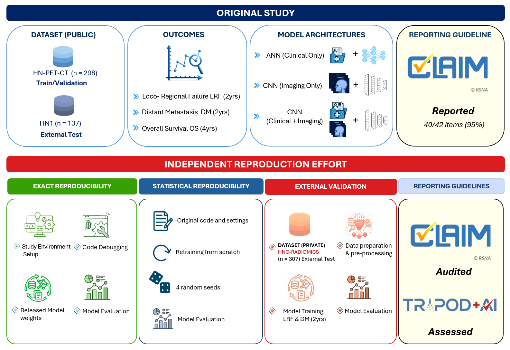

# Independent reproduction and external validation of image-based deep learning prognostic models for head and neck cancer

[](https://opensource.org/licenses/MIT)
[](https://www.python.org/downloads/)
[](https://pytorch.org/)

This repository contains the code, data, trained models, logs and results needed to reproduce our **independent reproducibility study** of:

> Mateus P. *et al.* **Image based prognosis in head and neck cancer using convolutional neural networks: a case study in reproducibility and optimization.** *Scientific Reports* 13, 18176 (2023). [doi:10.1038/s41598-023-45486-5](https://doi.org/10.1038/s41598-023-45486-5) · [original code](https://github.com/MaastrichtU-CDS/hn_cnn)

The goal of this repository is that **anyone can repeat every step of our study**: re-running the released weights, retraining the models from scratch, running external validation, and checking our numbers against the logs and reports stored here.

---

## Table of contents

1. [Study overview](#1-study-overview)
2. [Key findings](#2-key-findings)
3. [Repository structure](#3-repository-structure)
4. [Installation](#4-installation)
5. [Data](#5-data)
6. [Reproducing the study, step by step](#6-reproducing-the-study-step-by-step)
   - [6.1 Exact reproducibility (released weights)](#61-exact-reproducibility-released-weights)
   - [6.2 Statistical reproducibility (retraining with random seeds)](#62-statistical-reproducibility-retraining-with-random-seeds)
   - [6.3 External validation (HNC-RADIOMICS)](#63-external-validation-hnc-radiomics)
   - [6.4 Pre-processing your own DICOM data](#64-pre-processing-your-own-dicom-data)
   - [6.5 Summaries, AUC/CI and plots](#65-summaries-aucci-and-plots)
   - [6.6 Interpreting the results: from saved weights to AUC values](#66-interpreting-the-results-from-saved-weights-to-auc-values)
7. [Configuration reference](#7-configuration-reference)
8. [Models](#8-models)
9. [Known reproducibility issues and fixes](#9-known-reproducibility-issues-and-fixes)
   - [9.1 Machine (CPU-architecture) variability](#91-machine-cpu-architecture-variability-reported-by-mateus-et-al)
10. [Citation](#10-citation)
11. [Acknowledgements, funding, license and contact](#11-acknowledgements-funding-license-and-contact)

---

## 1. Study overview

<p align="center">
  
</p>
<p align="center"><b>Figure 1.</b> Schema showing independent reproduction of work by Mateus et al. (2023).</p>

The original study trained models to predict three outcomes in head and neck cancer:

| Outcome | Abbreviation | Time frame |
|---|---|---|
| Loco-regional failure | LRF | 2 years |
| Distant metastasis | DM | 2 years |
| Overall survival | OS | 4 years |

For each outcome, three model types were built: **ANN (clinical only)**, **CNN (imaging only)** and **CNN (imaging + clinical)**. Each was evaluated with two validation strategies: a **cohort split** and **5-fold stratified cross-validation**.

Our independent reproduction effort has four parts:

| Part | What we did |
|---|---|
| **Exact reproducibility** | Set up the original environment, debugged the code and evaluated the **released model weights** on the original data. |
| **Statistical reproducibility** | Retrained all models **from scratch** with the original code, hyperparameters and data splits, using **4 random seeds** (the authors' seed plus seeds 11, 22 and 33). |
| **External validation** | Ran the full pre-processing pipeline and model training for **LRF and DM** on a geographically distinct private cohort, **HNC-RADIOMICS** (Christian Medical College Vellore, India). |
| **Reporting guidelines** | Audited the original study with **CLAIM** and assessed it with **TRIPOD+AI**. |

---

## 2. Key findings

- **Exact reproducibility:** for the 6 models with released weights, the reproduced AUCs were within 0.01 of the original values, and within the original 95% CIs.
- **Statistical reproducibility:** the mean test AUCs over 4 random seeds differed from the original AUCs by more than 0.03 in 6 of 18 models.
- **External validation:** test AUCs for LRF were within the original 95% CI. For DM, the best model was the clinical-only ANN with an AUC of 0.74, against an original AUC of 0.86.
- **Reporting:** Mateus et al. reported 95% CLAIM compliance. Our audit, done from a reproduction point of view, scored 86%.
- **Effort:** resolving the barriers to reproduction took about **seven weeks** of elapsed time.

The full tables are in the manuscript. The underlying numbers are in [`results/`](results/).

---

## 3. Repository structure

```
reproducibility-hnc-cnn/
├── README.md
├── LICENSE
├── requirements.txt               # pinned dependencies (use this)
├── requirements_env_complete.txt  # full `pip freeze` of the environment we used
├── setup.py                       # installs the `hn_cnn` package
│
├── hn_cnn/                        # core library (from the original study)
│   ├── cnn.py                     # ANN / CNN / LR architectures
│   ├── fit.py                     # training loop, model selection, prediction
│   ├── parse_data.py              # dataset loader + clinical-variable harmonisation
│   ├── data_augmentation.py       # flips, 90° rotations, rotations, shifts
│   ├── image_preprocessing.py     # pre-processing helpers
│   ├── metrics.py, utils.py, constants.py
│
├── data/
│   ├── pre-processed/             # ready-to-use model inputs
│   │   ├── canada.csv + canada_c/                       # HN-PET-CT (n = 298), training / validation
│   │   ├── maastro.csv + maastro_c/                     # HN1 (n = 137), external test
│   │   ├── anonymized_cmc.csv + anonymized_cmc_png/     # HNC-RADIOMICS (de-identified), external validation
│   │   └── *.ipynb                                      # event-rate / follow-up / ID checks
│   ├── original_data/             # original clinical CSVs from the authors' repository
│   ├── seeds.xlsx                 # random seeds used by the original authors
│   └── README.md                  # data notes from the original repository
│
├── scripts/
│   ├── preprocessing/             # DICOM → NIfTI → reorientation → slice selection → PNG
│   ├── training/                  # training scripts per outcome (used in this study)
│   │   ├── variants/              # earlier iterations kept for transparency
│   │   └── original_examples/     # unmodified training examples from the original repo
│   ├── inference/predict_original_weights.py   # evaluate any saved weights
│   ├── analysis/make_plots.py                  # ROC curves from prediction CSVs
│   ├── analysis/extract_epoch_metrics.py       # selected epoch → train/val/test AUC from logs
│   └── utils/fslinstaller.py                   # FSL installer
│
├── notebooks/
│   ├── data_preparation/          # RTSTRUCT checks, DICOM→NIfTI, anonymisation, volume/area
│   ├── preprocessing/             # HU calibration, LRR timing, final PNG creation
│   └── analysis/                  # mean AUC & CI over folds, parameter counts, 2-year analysis
│
├── results/
│   ├── models/original_paper_weights/   # weights released by Mateus et al. (+ with_clinical_data/)
│   ├── exact_reproducibility/           # inference CSVs, ROC plots, CV reports
│   ├── statistical_reproducibility/     # seeds/{original_author_seed,seed_11,seed_22,seed_33}/{logs,models}
│   │                                    # inference, plots, CV reports
│   └── external_validation/             # logs, models, inference, plots, CV reports (HNC-RADIOMICS)
│
├── pre-processing_analysis_outputs/     # HU statistics and windowing / calibration figures
├── figures/                             # Figure 1, cohort figures, compliance figure
└── docs/                                # references and TRIPOD+AI checklists
```

---

## 4. Installation

### 4.1 System requirements

| Component | Used in this study |
|---|---|
| OS | Ubuntu 24.04 LTS (any recent Linux should work) |
| Python | 3.10 |
| GPU | NVIDIA Quadro RTX 5000 (optional; CPU training also works but is slower) |
| RAM | 16 GB minimum (peak ~7 GB during multimodal training) |
| FSL | 6.0. Only needed to pre-process **new DICOM data** ([§6.4](#64-pre-processing-your-own-dicom-data)) |

### 4.2 Set up the environment

```bash
git clone https://github.com/qirail/reproducibility-hnc-cnn.git
cd reproducibility-hnc-cnn

python3.10 -m venv hnc_cnn_env
source hnc_cnn_env/bin/activate

pip install --upgrade pip
pip install -r requirements.txt
pip install -e .            # makes `import hn_cnn` work from any script
```

Key pinned versions: `torch==1.13.1`, `torchvision==0.14.1`, `numpy==1.22.0`, `pandas==1.3.4`, `scikit-learn==1.5.0`, `Pillow==10.3.0`, `nibabel==3.2.1`, `dcmrtstruct2nii==1.0.19`.
`requirements_env_complete.txt` contains the full list of packages in our environment, in case you need to match it exactly.

> **Run every command from the repository root.** All paths in the scripts are relative to it, for example `data/pre-processed/...` and `results/...`.

---

## 5. Data

| Cohort | Source | Patients | Role | Files in this repo |
|---|---|---|---|---|
| **HN-PET-CT** (4 Canadian centres: HGJ, CHUS, HMR, CHUM) | [TCIA, doi:10.7937/K9/TCIA.2017.8oje5q00](https://doi.org/10.7937/K9/TCIA.2017.8oje5q00) | 298 | Training / validation | `data/pre-processed/canada.csv`, `canada_c/` |
| **HN1** (MAASTRO, Netherlands) | [TCIA, doi:10.7937/tcia.2019.8kap372n](https://doi.org/10.7937/tcia.2019.8kap372n) | 137 | External test (original study) | `data/pre-processed/maastro.csv`, `maastro_c/` |
| **HNC-RADIOMICS** (CMC Vellore, India) | Private, prospectively recruited 2021–2025 | 102 (of 307 recruited) | External validation (this study) | `data/pre-processed/anonymized_cmc.csv`, `anonymized_cmc_png/` |

- **Images:** one 180×180, 8-bit PNG per patient, showing the CT slice with the largest GTV area after pre-processing.
- **Clinical CSVs:** contain the features used by the models (T-stage, N-stage and tumour volume, one-hot encoded inside `hn_cnn/parse_data.py`) plus event indicators and times in days.
- **Cohort split:** HGJ + CHUS for training and HMR + CHUM for validation. This is handled automatically from the patient IDs.
- **Inclusion rule:** this follows the original code. Patients with an event inside the time frame are kept. Patients without an event are kept only if their follow-up is at least as long as the time frame.

> **HNC-RADIOMICS:** 307 patients were recruited over the 5-year study period, and the **102 patients who completed 2 years of follow-up** are used for external validation and released here. When the 2-year inclusion rule is applied, the loader keeps 102 patients for LRF (42 events) and 74 for DM (9 events).
>
> The cohort is shared only in de-identified, pre-processed form, with anonymised IDs `HN0001`, `HN0002`, … No raw DICOM data or direct identifiers are included.

---

## 6. Reproducing the study, step by step

All training scripts are configured by editing the **`DATA`** and **`CONFIGURATIONS`** blocks at the top of the file (see [§7](#7-configuration-reference)). They share the same structure:

| Script | Outcome | Default model type |
|---|---|---|
| `scripts/training/training_dm.py` | DM, 2 years | CNN, imaging only |
| `scripts/training/training_dm_cd.py` | DM, 2 years | CNN, imaging + clinical (`CLINICAL_VARIABLES: True`) |
| `scripts/training/training_lrf.py` | LRF, 2 years | imaging only |
| `scripts/training/training_lrf_cd.py` | LRF, 2 years | clinical (`CLINICAL_VARIABLES: True`) |
| `scripts/training/training_os.py` | OS, 4 years | imaging only |
| `scripts/training/training_os_cd.py` | OS, 4 years | clinical (`CLINICAL_VARIABLES: True`) |

To switch between the three model types, set:

| Model type | `MODEL` | `CLINICAL_VARIABLES` |
|---|---|---|
| ANN (clinical only) | `ANN` | `True` |
| CNN (imaging only) | `CNN` | `[]` |
| CNN (imaging + clinical) | `CNN` | `True` |

To switch the validation strategy, set `DATA_SPLIT` to `COHORT_SPLIT` or `CROSS_VALIDATION` (with `FOLDS: 5`).

### 6.1 Exact reproducibility (released weights)

The six models released by Mateus et al. are stored in `results/models/original_paper_weights/`:

| Outcome | Imaging only | Imaging + clinical (`with_clinical_data/`) |
|---|---|---|
| DM | `model_dm_689.pth.tar` | `model_dm_cd_646.pth.tar` |
| LRF | `model_lrf_2340.pth.tar` | `model_lrf_cd_964.pth.tar` |
| OS | `model_os_1341.pth.tar` | `model_os_cd_2445.pth.tar` |

1. Open `scripts/inference/predict_original_weights.py` and edit the **Settings** block:
   ```python
   RESULTS_DIR = "results/exact_reproducibility/inference"
   WEIGHTS_DIR = "results/models/original_paper_weights"     # use .../with_clinical_data for the *_cd models
   RUN_CANADA, RUN_HN1, RUN_CMC = True, True, False
   ```
2. In `RUNS`, uncomment the entries under `Exact Reproducibility` and comment out the others.
3. Run:
   ```bash
   python scripts/inference/predict_original_weights.py
   ```
4. Compare `RESULTS_DIR/summary.txt` with our outputs in `results/exact_reproducibility/inference/` and the ROC curves in `results/exact_reproducibility/plots/`. The AUCs should be within ±0.01 of the original values.

### 6.2 Statistical reproducibility (retraining with random seeds)

1. Keep the default `DATA` paths: `canada` for training/validation and `maastro` for testing.
2. Choose `MODEL`, `CLINICAL_VARIABLES` and `DATA_SPLIT` (see the table above).
3. Run one outcome, for example LRF:
   ```bash
   python scripts/training/training_lrf.py
   ```
   `training_lrf*.py` and `training_os*.py` automatically launch **one process per seed** in `SEEDS = [11, 22, 33]`, each with `THREADS` CPU threads. Each seed writes to:
   ```
   results/statistical_reproducibility/seeds/seed_<SEED>/logs/
   results/statistical_reproducibility/seeds/seed_<SEED>/models/
   seed_<SEED>.out                  # console output of that seed
   ```
4. To use the **original authors' seed**, take the values for the outcome, model and split from `data/seeds.xlsx`. Put them in the commented `random.seed(...)`, `random_seed_split` and `torch.manual_seed(...)` lines of the seed block, and comment out the `SEED`-based lines. The DM scripts already use the original seeds (`random.seed(7651962)`, `torch.manual_seed(775135)` for imaging DM).
5. Run inference on the saved models with `predict_original_weights.py`. Set `WEIGHTS_DIR` to the seed's `models/` folder and use the `Statistical Reproducibility` run list.
6. Compare your results with ours in `results/statistical_reproducibility/` (`cv_reports/`, `inference_seed_11/`, `plots_seed_11/`, `seeds/*/logs/`).

**Expected cost:** about 17–19 h per outcome for 5-fold CV on our hardware, and about 7 GB peak memory.

> Because of non-determinism in training (data shuffling, and dropout behaving differently on ARM and x86 CPUs; see [§9.1](#91-machine-cpu-architecture-variability-reported-by-mateus-et-al)), the retrained AUCs will **not** be bit-identical to ours. In the study we used a tolerance of **|ΔAUC| ≤ 0.03**.

### 6.3 External validation (HNC-RADIOMICS)

1. `training_dm.py` and `training_dm_cd.py` already use the external cohort as `TESTING`. For the other scripts, set:
   ```python
   TESTING: {
       CLINICAL_DATA_PATH: "data/pre-processed/anonymized_cmc.csv",
       SCANS_PATH: "data/pre-processed/anonymized_cmc_png",
   }
   ```
2. Use the DM or LRF scripts (OS was not evaluated because no patient had reached 4-year follow-up). Point `LOGS_PATH` and `MODEL_PATH` to `results/external_validation/...`.
3. Data augmentation: random horizontal and vertical flips (p = 0.5), random 90° rotations, random rotation of 0–20°, and horizontal/vertical shifts of 3%.
4. Run inference with `predict_original_weights.py`, setting `RUN_CMC = True`, `WEIGHTS_DIR = "results/external_validation/models"` and `RESULTS_DIR = "results/external_validation/inference"`.
5. Compare with `results/external_validation/` (`logs/`, `inference/`, `plots/`, `cv_reports/`).

### 6.4 Pre-processing your own DICOM data

You only need this step to apply the models to a **new cohort**. The PNGs for all three cohorts are already provided. The pipeline is:

| # | Step | Script / notebook |
|---|---|---|
| 1 | Check RTSTRUCT names and select the GTV | `notebooks/data_preparation/check_RTstructure_name.ipynb` |
| 2 | Convert CT DICOM and RTSTRUCT to NIfTI (`dcmrtstruct2nii`) | `scripts/preprocessing/convert_dicom.py`, `notebooks/data_preparation/convert_dicom_to_nifti.ipynb` |
| 3 | Resample to uniform pixel spacing and calibrate HU | `notebooks/preprocessing/calculate_HU_value.ipynb` |
| 4 | Reorient to MNI152 with FSL and apply the GTV mask | `scripts/preprocessing/fsl_reorient_final.sh`, `run_fsl_docker.py`, `apply_mask_to_nifti.py` |
| 5 | Select the slice with the **largest GTV area** (corrected, see [§9](#9-known-reproducibility-issues-and-fixes)) | `scripts/preprocessing/windowing_cropping.py` |
| 6 | HU window −50 to 300 HU | ″ |
| 7 | Gaussian filter, σ = 0.5 | ″ |
| 8 | Crop to 180×180 px around the tumour centroid | ″ |
| 9 | Normalise intensity to 0–255 and save as 8-bit PNG | ″, `notebooks/preprocessing/create_final_pngs.ipynb` |
| 10 | Compute tumour volume/area and build the clinical CSV | `notebooks/data_preparation/calculate_volume_area.ipynb`, `cmc_column_transformed.ipynb`, `notebooks/preprocessing/calculate_LRR_in_Days.ipynb` |
| — | De-identify DICOM metadata | `notebooks/data_preparation/Dicom_metadata_anonymization.ipynb` |

`windowing_cropping.py` reads its paths from environment variables:

```bash
SCANS_PATH=/path/to/nifti/scans \
MASKS_PATH=/path/to/nifti/masks \
OUTPUT_PATH=/path/to/output_pngs \
python scripts/preprocessing/windowing_cropping.py
```

FSL 6.0 must be installed (`scripts/utils/fslinstaller.py`) and `FSLDIR` must be set.

### 6.5 Summaries, AUC/CI and plots

| Task | Tool |
|---|---|
| Mean AUC and range / 95% CI over the 5 folds | `notebooks/analysis/Calculate mean AUC_&_CI for k-fold CV results.ipynb` → `results/*/cv_reports/*.txt` |
| ROC curves from prediction CSVs | `python scripts/analysis/make_plots.py <inference_dir> <output_dir>` |
| Number of trainable parameters | `notebooks/analysis/calculate_trainable_parameters.ipynb` |
| Two-year follow-up analysis of HNC-RADIOMICS | `notebooks/analysis/cmc_two_year_analysis.ipynb` |
| Event rates, median follow-up, ID checks | `data/pre-processed/*.ipynb` |

For cohort-split models, 95% CIs are computed by bootstrap with 1000 resamples. For 5-fold CV, we report the mean AUC with its range across folds.

### 6.6 Interpreting the results: from saved weights to AUC values

Training runs for a fixed number of epochs (3000 by default). **It does not save a model at every epoch.** A checkpoint `model_<id>_<epoch>.pth.tar` is written only when **all three** of these conditions hold at that epoch (`hn_cnn/fit.py`):

1. The validation AUC is **higher than at any earlier saved epoch**.
2. The validation AUC is **above `THRESHOLD`**.
3. The gap |train AUC − validation AUC| is **below `MAX_DIFFERENCE`**.

So the checkpoints in a `models/` folder form a sequence of improving models. **The file with the highest epoch number is the selected (final) model.** Its AUC values are not stored in the file name. You read them from the log file at that epoch.

> **Tip:** use a fresh, empty `models/` folder for each run. Otherwise checkpoints from an earlier run can be mistaken for the selected model.

#### Cohort split (single train / validation / test)

1. **Find the selected epoch.** Take the checkpoint with the highest epoch number in the models folder. For example, if `results/statistical_reproducibility/seeds/seed_11/models/` contains `model_dm_45 … model_dm_396, model_dm_512`, the selected epoch is **512**.
2. **Open the matching log**, for example `.../seed_11/logs/log_dm.txt`, and search for the line `Epoch 512/3000`.
3. Directly below it are three blocks: `TRAIN_METRICS`, `VALIDATION` and `TESTING`. In each block, write down the **ROC AUC**, which is the value in `'ROC': {'AUC': ...}`. **Don't use the `'PR'` AUC**, which appears later on the same line. The 95% CI is in `'CI': {... 'LOWER_BOUND': ..., 'HIGHER_BOUND': ...}`.
   ```
   Epoch 512/3000
   TRAIN_METRICS
   {'LOSS': ..., 'ROC': {'AUC': 0.8483, ..., 'CI': {..., 'LOWER_BOUND': 0.7287, 'HIGHER_BOUND': 0.9373}}, 'PR': {...}}
   VALIDATION
   {'LOSS': ..., 'ROC': {'AUC': 0.8741, ...}}
   TESTING
   {'LOSS': ..., 'ROC': {'AUC': 0.8515, ...}}
   ```
4. Report these as the **train, validation and test (HN1 or HNC-RADIOMICS) AUCs with their 95% CIs**, and compare them with the original values.

The helper script does steps 1–3 for you:

```bash
python scripts/analysis/extract_epoch_metrics.py \
    --log    results/statistical_reproducibility/seeds/seed_11/logs/log_dm.txt \
    --models results/statistical_reproducibility/seeds/seed_11/models \
    --prefix model_dm_
# Selected epoch: 512
#   TRAIN_METRICS  ROC AUC 0.8483 [0.7287-0.9373]
#   VALIDATION     ROC AUC 0.8741 [0.7416-0.9689]
#   TESTING        ROC AUC 0.8515 [0.6807-0.9725]
```

You can also pass the epoch directly with `--epoch 512`. To recompute the AUCs from the saved weights, run `scripts/inference/predict_original_weights.py` on that checkpoint (see [§6.1](#61-exact-reproducibility-released-weights)).

#### 5-fold cross-validation

Each fold is a separate training run, with its own log `log_<id>_5-fold_cv_fold<k>.txt` and its own checkpoints `model_<id>_5-fold_cv_fold<k>_<epoch>.pth.tar`.

1. For **each fold k = 0…4**, take the checkpoint with the **highest epoch** for that fold.
2. Open that fold's log, find `Epoch <n>/3000`, and write down the train, validation and test **ROC AUC** as above.
3. Compute the **mean AUC and the range [min, max]** over the folds. For CV we report the range, not a bootstrap CI.

#### When one or more folds have no saved weights

The save conditions are strict, so a fold may finish all 3000 epochs **without ever saving a checkpoint**. This means no epoch reached the validation-AUC threshold while keeping the train–validation gap small enough. In that case:

- **The fold has no selected model, so it is excluded.** Do not take the last epoch's or the best epoch's values from the log for that fold, because that model did not pass the selection criteria.
- **Compute the mean and range over the folds that did save a model**, and always report how many folds contributed, e.g. *"mean test AUC 0.80 [0.72–0.87], 3/5 folds"*.
- All CV reports in this repository follow this rule. The `Number of folds` line in each `results/*/cv_reports/*.txt` file gives the number of contributing folds, and the fold-by-fold table lists which ones were used.
- **If only a few folds (or none) saved a model, the estimate is less reliable.** Interpret it with caution and consider the range rather than the mean alone.
- **For a cohort-split run with no saved checkpoint:** following the original methodology, relax the selection criteria and retrain. Gradually increase `MAX_DIFFERENCE` (starting at 0.05) and/or lower `THRESHOLD` until a model is saved. Report the values you used.

Example (DM, imaging only, seed 11): folds 1 and 2 saved no weights.

```bash
python scripts/analysis/extract_epoch_metrics.py --cv \
    --logs   results/statistical_reproducibility/seeds/seed_11/logs \
    --models results/statistical_reproducibility/seeds/seed_11/models \
    --log-stem log_dm_5-fold_cv --model-stem model_dm_5-fold_cv
```
```
Fold  Saved  Epoch  Train AUC  Val AUC    Test AUC
0     Yes    370    0.8457     0.8510     0.8725
1     No     -      excluded (no checkpoint saved)
2     No     -      excluded (no checkpoint saved)
3     Yes    286    0.8654     0.8800     0.8179
4     Yes    419    0.9245     0.9520     0.7199

Folds with a saved model: 3/5
  Train       mean 0.8785  range [0.8457, 0.9245]
  Validation  mean 0.8943  range [0.8510, 0.9520]
  Test        mean 0.8035  range [0.7199, 0.8725]
```

This matches `results/statistical_reproducibility/cv_reports/DM_Statistical_Repro_seed_11_Imaging_5-fold_CV_report.txt`.

---

## 7. Configuration reference

**`CONFIGURATIONS` block in the training scripts**

| Key | Meaning |
|---|---|
| `MODEL` | `CNN`, `ANN` or `LR` |
| `DATA_SPLIT` | `COHORT_SPLIT` or `CROSS_VALIDATION` |
| `FOLDS` | number of CV folds (5) |
| `TIME_TO_EVENT` | time frame in days: `2*365` for DM/LRF, `4*365` for OS |
| `EVENT` | `DM`, `LRF` or `OS` |
| `HYPERPARAMETERS` | overrides of the defaults below |
| `BATCH_SIZE` | 64 |
| `LOGS_PATH` | log file (per epoch, train/validation/test AUC) |
| `CLINICAL_VARIABLES` | `True` to include the 11 clinical features, `[]` for imaging only |
| `DATA_AUGMENTATION` | `HORIZONTAL_FLIP`, `VERTICAL_FLIP`, `ROTATE_90`, `ROTATION`, ... |
| `STORE_MODEL` | `MODEL_ID`, `MODEL_PATH`, `THRESHOLD` (minimum validation AUC), `MAX_DIFFERENCE` (maximum train–validation AUC gap) |

**Default hyperparameters (same for ANN and CNN)**

| Parameter | Value |
|---|---|
| Optimiser | SGD, learning rate 0.05, momentum 0.9 |
| Weight decay (L2) | 1 × 10⁻⁴ |
| Activation | Leaky ReLU (slope 0.01) |
| Dropout (CNN FC layers) | 0.3 / 0.2 / 0.1 |
| Class weights | `[0.7, 3.7]` (non-event, event) |
| Model selection | epoch with the highest validation AUC whose train–validation AUC gap is below a threshold (starting at 0.05 and relaxed gradually) |

**Clinical features** (`hn_cnn/parse_data.py`):
```python
features = tabular[["n0", "n1", "n2", "t1", "t2", "t3", "t4", "vol0", "vol1", "vol2", "vol3"]]
```
T-stage has 4 categories, N-stage has 3 (N2 includes N3), and volume has 4 quartile bins: 0–11, 11–24, 24–43 and > 43 × 10³ mm³. If you change this list, also change the input size in `hn_cnn/cnn.py`.

---

## 8. Models

| Model | Input | Architecture |
|---|---|---|
| **ANN** | 11 clinical features | 11 → 8 → 4 → 1 (fully connected, sigmoid output) |
| **CNN** | 180×180 grayscale PNG | 3 conv blocks (8/16/32 filters; conv + max-pool + Leaky ReLU) → 4×4×32 = 512 features → FC 512→128→64→32 (dropout) → 1 (sigmoid) |
| **CNN + clinical** | PNG + 11 clinical features | CNN as above; the 11 clinical features are concatenated with the 32 image features before the output neuron |

---

## 9. Known reproducibility issues and fixes

We document every change needed to run the original code. The architecture, hyperparameters and methodology were **not** changed. The full list of barriers, resolutions and time needed is in Table 6 of the manuscript.

- **Slice-selection bug (pre-processing).** The original algorithm chose the slice with the largest *total* mask pixel count. On HNC-RADIOMICS this often picked slices without tumour. Our two-pass fix in `scripts/preprocessing/windowing_cropping.py` first finds the slices that contain tumour, then picks the one with the largest GTV area. With the fix, the selected slice contained tumour in **100%** of HNC-RADIOMICS patients, compared with **60%** for the original code.
- **HU windowing check.** The −50 to 300 HU window captured 97.3% of tumour pixels in HNC-RADIOMICS. See `pre-processing_analysis_outputs/`.
- **Machine (CPU-architecture) variability.** This is a known caveat reported by the original authors. See [§9.1](#91-machine-cpu-architecture-variability-reported-by-mateus-et-al).
- **Missing weights.** Weights were released for only 6 of the 18 original models. The remaining 12 could only be assessed by retraining (statistical reproducibility).
- **Earlier script versions.** These are kept in `scripts/training/variants/` and the unmodified original scripts in `scripts/training/original_examples/`, so the changes can be traced.

### 9.1 Machine (CPU-architecture) variability, reported by Mateus et al.

Mateus et al. trained their models on [DSRI](https://dsri.maastrichtuniversity.nl), an OpenShift server cluster. Their [repository](https://github.com/MaastrichtU-CDS/hn_cnn) reports that, **even with identical seeds, `torch.nn.Dropout` behaves differently on different CPU architectures**. They attribute this to the CPU architecture and state that **an ARM CPU** is needed to obtain *their exact* results. They tested this on AWS with an Ubuntu 24.04 LTS image and a `t4g.micro` 64-bit ARM CPU.

Their example (same seeds; `torch.randn` agrees across machines, but the dropout mask does not):

```python
import random, torch
random.seed(7651962)
random_seed_split = random.randint(0, 9174937)
torch.manual_seed(775135)

data = torch.randn(4, 4)            # identical on all machines
torch.nn.Dropout(p=0.3)(data)       # differs between machines

# ARM (DSRI / AWS t4g), as used for the original results:
# tensor([[-1.0361, -3.5810, -1.1379,  1.8477],
#         [-0.0000, -1.2687, -0.0000,  1.7217],
#         [-1.4952, -2.3690, -0.0955, -0.0000],
#         [-0.4844,  1.5011,  1.8367,  2.3154]])
# x86:
# tensor([[-1.0361, -0.0000, -0.0000,  1.8477],
#         [-2.0117, -1.2687, -0.0785,  0.0000],
#         [-0.0000, -2.3690, -0.0955, -0.0000],
#         [-0.4844,  1.5011,  1.8367,  2.3154]])
```

According to the original authors, the following settings did **not** remove the difference:

```python
device = torch.device("cpu")
torch.backends.cudnn.deterministic = True
torch.set_num_threads(1)
```

As a possible future fix, they suggest a custom dropout implementation:

```python
mask = torch.distributions.Bernoulli(probs=(1 - p)).sample(x.size())
x[~mask.bool()] = x.mean()
out = x * mask * 1 / (1 - p)
```

**How this relates to our study**

- All our experiments ran on an **x86-64** workstation (Ubuntu 24.04 LTS, NVIDIA Quadro RTX 5000), not on ARM.
- **Exact reproducibility is not affected.** When saved weights are evaluated, the model is in `eval()` mode and dropout is switched off. This is consistent with our reproduced AUCs being within 0.01 of the originals.
- **Statistical reproducibility (retraining) is affected.** Dropout is active during training, so the same seed can produce a different model on a different CPU architecture. This is one possible contributor to the differences we observed after retraining, together with seed-to-seed variability. That is why we report results over 4 seeds and use a tolerance of |ΔAUC| ≤ 0.03.
- **For new users:** if you need bit-identical retraining of the *original* models, use an ARM CPU as Mateus et al. recommend. If you retrain on x86, expect your results to differ from the original values, and possibly from ours as well.

---

## 10. Citation

If you use this repository, please cite our study:

```bibtex
@article{shaikh_hnc_reproducibility,
  title   = {Independent reproduction and external validation of image-based deep learning prognostic models for head and neck cancer},
  author  = {Shaikh, Hasan and A, Sathya and C, Praveenraj and S, Balu Krishna and Irodi, Aparna and Kuchipudi, Rajendra Benny and Victor, Jino Wilson and Mathew, Manu and Isiah, Rajesh and Pavamani, Simon Pradeep and Mammen, Joy John and Thomas, Hannah Mary T},
  note    = {Manuscript under review},
  url     = {https://github.com/qirail/reproducibility-hnc-cnn}
}
```

and the original study:

```bibtex
@article{mateus2023image,
  title     = {Image based prognosis in head and neck cancer using convolutional neural networks: a case study in reproducibility and optimization},
  author    = {Mateus, Pedro and Volmer, Leroy and Wee, Leonard and Aerts, Hugo JWL and Hoebers, Frank and Dekker, Andre and Bermejo, Inigo},
  journal   = {Scientific Reports},
  volume    = {13},
  number    = {1},
  pages     = {18176},
  year      = {2023},
  doi       = {10.1038/s41598-023-45486-5}
}
```

Please also cite the TCIA datasets: Vallières *et al.*, Head-Neck-PET-CT (2017), and Wee & Dekker, HEAD-NECK-RADIOMICS-HN1 (2019).

---

## 11. Acknowledgements, funding, license and contact

- **Original authors** (Mateus *et al.*), for releasing their code, data and weights, and for answering our questions during the reproduction.
- **The Cancer Imaging Archive (TCIA)**, for the public datasets.
- **Funding:** DBT-Wellcome Trust India Alliance Early Career Fellowship, awarded to H.M.T.T.
- **License:** MIT (see [LICENSE](LICENSE)). The data in `data/` are subject to the terms of their original sources.

**Contact**
- Hasan Shaikh: [GitHub @hash123shaikh](https://github.com/hash123shaikh)
- Dr. Hannah Mary T. Thomas (corresponding author): hannah.thomas@cmcvellore.ac.in
- Quantitative Imaging Research and Artificial Intelligence Lab (QIRAIL), Department of Radiation Oncology Unit 2, Christian Medical College Vellore, Tamil Nadu 632004, India
